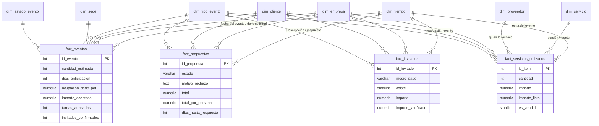

# Data warehouse

Base analítica del sistema de eventos: responde preguntas de negocio (cuánto se vende, en qué
temporada, por qué se pierden propuestas, cómo se cobran los invitados) sin tocar la base que usa
el sistema todos los días.

| Archivo | Qué hace |
|---|---|
| `01-esquema.sql` | Crea el esquema `dw` con el modelo estrella (dimensiones y hechos). Lo borra y lo crea de cero |
| `02-etl.sql` | Crea el procedimiento `dw.cargar()`: extrae de `public.*`, transforma y carga en `dw.*` |
| `03-vistas.sql` | Vistas de análisis (`dw.v_*`), una por pregunta de negocio |
| `04-consultas.sql` | Consultas OLAP de ejemplo: roll-up, drill-down, slice, dice, pivot, rankings |
| `datos-historicos.sql` | Opcional: una empresa de demostración con ~3 años de actividad, para tener volumen |
| `borrar-datos-historicos.sql` | Saca esa empresa de demostración |

## Base operacional vs. data warehouse

| | Base del sistema (`public`) | Data warehouse (`dw`) |
|---|---|---|
| Para qué | Operar: cargar, modificar, consultar un evento | Analizar: totales, tendencias, comparaciones |
| Tipo | OLTP | OLAP |
| Modelo | Normalizado (3FN), muchas tablas chicas | Estrella: hechos al centro, dimensiones alrededor |
| Datos | Estado actual | Historia (por ejemplo, precios de lista de cada época) |
| Escribe | El sistema, todo el tiempo | Solo el ETL, una vez por día |
| Consultas | Cortas, por id | Grandes, agregando miles de filas |

El warehouse vive en el **esquema `dw` de la misma base de PostgreSQL**. Así el ETL lee con SQL
directo (sin copiar archivos entre servidores) y no hace falta otro contenedor ni más memoria en el
VPS. Como el sistema y los análisis no comparten tablas, las consultas pesadas no bloquean a nadie.

## Modelo estrella



Son cuatro estrellas que comparten dimensiones (una **constelación**, o *esquema de galaxia*): por
ejemplo, `dim_tiempo` y `dim_cliente` sirven igual para eventos, propuestas e invitados, así que se
pueden comparar entre sí.

### Hechos: qué se mide y con qué grano

El **grano** es qué representa cada fila. Definirlo primero evita sumar dos veces lo mismo.

| Tabla de hechos | Grano (una fila por…) | Medidas principales |
|---|---|---|
| `fact_eventos` | evento (solicitud) | personas, días de anticipación, ocupación del salón, importe vendido, tareas atrasadas, invitados confirmados |
| `fact_propuestas` | propuesta | subtotal, descuento, total, total por persona, días hasta la respuesta, aceptada/rechazada |
| `fact_servicios_cotizados` | ítem de una propuesta | cantidad, precio cobrado, importe, importe a precio de lista, vendido |
| `fact_invitados` | respuesta de un invitado | asiste, medio de pago, importe a cobrar, importe verificado |

Las banderas (`es_aceptada`, `asiste`, `es_vendido`…) son 0/1 para poder **sumarlas**: `SUM(asiste)`
es la cantidad de asistentes. Datos como `estado`, `motivo_rechazo` o `medio_pago` quedan en el hecho
como **dimensiones degeneradas** (no justifican una tabla propia).

### Dimensiones

| Dimensión | Atributos para agrupar | Cómo se actualiza |
|---|---|---|
| `dim_tiempo` | año, semestre, trimestre, mes, semana, día de la semana, fin de semana, **temporada escolar** | Se genera (2020-2030 y lo que haga falta) |
| `dim_empresa` | organizadora, tipo de cuenta (prueba gratuita / sin límite) | SCD tipo 1 |
| `dim_cliente` | centro, tipo, institución | SCD tipo 1 |
| `dim_tipo_evento` | egresados, bienvenida… | SCD tipo 1 |
| `dim_sede` | salón, capacidad, rango de capacidad | SCD tipo 1 |
| `dim_proveedor` | proveedor, o *Equipo propio* / *Sin asignar* | SCD tipo 1 |
| `dim_servicio` | servicio, precio de lista, **vigencia** | **SCD tipo 2** |
| `dim_estado_evento` | estado y **etapa del embudo** (en curso, ganado, perdido) | Fija |

- **Claves sustitutas** (`sk_*`): el warehouse usa sus propias claves. La de la base del sistema
  queda como `id_*` (clave natural). Eso permite tener varias versiones de un mismo servicio.
- **Miembros especiales**: `0 = Sin dato` (un evento sin salón) y `-1 = Equipo propio` en
  proveedores. Así las FK nunca son NULL y los análisis no pierden filas.
- **`dim_tiempo` usa `AAAAMMDD` como clave** (`20261113`): se lee fácil y ordena bien.
- **SCD tipo 2 en servicios**: el sistema solo guarda el precio de lista *actual*. Cada vez que
  cambia, el ETL cierra la versión vigente (`vigente_hasta`) y abre otra. Cada ítem cotizado apunta a
  la versión vigente cuando se presentó la propuesta, así se puede comparar lo cobrado contra la lista
  de ese momento (`importe_lista`). La historia arranca cuando se instala el warehouse: la primera
  versión vale "desde siempre".

## ETL

`CALL dw.cargar();` hace todo en una sola transacción:

1. **Extrae** de las tablas del sistema (`public.*`).
2. **Transforma**: traduce códigos a nombres (`centro_estudiantes` → *Centro de estudiantes*),
   calcula totales y medidas derivadas (días hasta la respuesta, ocupación, atrasos), asigna la
   temporada, busca la versión del servicio vigente y resuelve quién dio cada servicio.
3. **Carga**: las dimensiones se actualizan (upsert, sus claves no cambian entre corridas) y los
   hechos se recalculan completos (con este volumen tarda ~1 segundo y un evento que cambió de estado
   queda bien sin lógica incremental).

Cada corrida queda en `dw.etl_ejecuciones` (inicio, fin, filas por tabla o el error). Si algo falla,
no se carga nada a medias.

```sql
SELECT id_ejecucion, estado, fin - inicio AS duracion, filas, error
  FROM dw.etl_ejecuciones ORDER BY id_ejecucion DESC LIMIT 5;
```

## Cómo usarlo

**En el VPS** (`intermaterias-infra/produccion`): el ETL corre todas las noches por cron.

```bash
bash scripts/etl.sh                 # instala el warehouse si falta y lo carga
bash scripts/etl.sh --datos-demo    # además carga la empresa de demostración
bash scripts/etl.sh --reinstalar    # borra dw y lo vuelve a crear (se pierde la historia de precios)
docker compose exec postgres psql -U eventos eventos   # y adentro: SELECT * FROM dw.v_embudo;
```

**En la demo local** (`intermaterias-infra`, con el stack levantado):

```bash
cd intermaterias-backend/database/warehouse
for f in 01-esquema.sql 02-etl.sql 03-vistas.sql; do
  docker compose -f ../../../intermaterias-infra/docker-compose.yml exec -T postgres \
    psql -U postgres -d eventos < $f
done
# opcional: datos-historicos.sql, después:  CALL dw.cargar();
```

## Preguntas que responde

| Pregunta | Dónde |
|---|---|
| ¿Cuánto se factura por mes? ¿Cuánto creció respecto del mes anterior? | `v_ventas_mensuales`, consultas 1 y 6 |
| ¿En qué temporada se concentra cada tipo de evento? | `v_temporadas`, consulta 2 (CUBE) |
| ¿Qué porcentaje de las solicitudes se gana? ¿Por qué se pierden? | `v_embudo`, `v_propuestas`, consulta 10 |
| ¿Qué servicios se venden más? ¿Se cobra por encima o por debajo de la lista? | `v_servicios`, consultas 7 y 9 |
| ¿Con qué proveedores se trabaja más? ¿Cuánto se resuelve con equipo propio? | `v_proveedores` |
| ¿Qué clientes concentran la facturación? | consulta 8 (Pareto) |
| ¿Qué asistencia hay? ¿Se paga en efectivo o por transferencia? ¿Cuánto falta cobrar? | `v_invitados`, consulta 11 |
| ¿Se aprovechan los salones? | consulta 4 (ocupación por sede) |

Todas las vistas incluyen la empresa: cada organizadora puede ver solo lo suyo
(`WHERE empresa = '…'`), y como dueños del sistema se ve el total.
